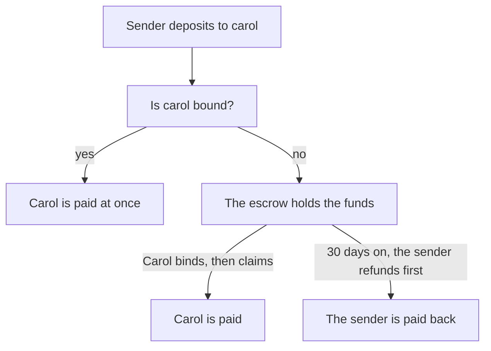

`HandleEscrow` lets you send ETH or tokens to a handle such as `carol` on
GitHub. If Carol has already proved the handle, she gets the funds right away.
If not, the escrow holds them. Then one of two things happens: Carol proves
the handle and claims the funds, or, after 30 days, the sender takes them
back first.



A paid deposit emits `Forwarded`, a held one `Deposited`. Held funds end one
of two ways, `Claimed` or `Refunded`, whichever comes first.

In this guide you are the sender. Set `RPC_URL` and `HANDLE_ESCROW` for
[Sepolia](/docs/networks/sepolia/), and `PRIVATE_KEY` to a key with
Sepolia ETH. To try it without spending anything, and to skip the 30-day
wait, run it on a [fork of Sepolia](/docs/guides/local-chain/) instead.
Nobody holds the GitHub handle `carol` on Sepolia, so the escrow keeps what
you send her.

## The sender's script

Create `sender.mjs`. Start with the setup:

```js
import { createPublicClient, createWalletClient, http } from 'viem';
import { privateKeyToAccount } from 'viem/accounts';
import { handleEscrowAbi, handleNode, platformId } from '@libid/contracts';

const transport = http(process.env.RPC_URL);
const client = createPublicClient({ transport });
const escrow = { address: process.env.HANDLE_ESCROW, abi: handleEscrowAbi };

const NATIVE = '0xEeeeeEeeeEeEeeEeEeEeeEEEeeeeEeeeeeeeEEeE';
```

`NATIVE` is the address the escrow uses for ETH.

### Hash the handle

The escrow takes the handle as a node, a SHA-256 hash of the handle.
Compute it on your side, so the handle itself is never sent to the RPC:

```js
const sender = createWalletClient({ account: privateKeyToAccount(process.env.PRIVATE_KEY), transport });

const node = handleNode('github', 'carol');
```

`handleNode` takes the platform key, not its id. It folds A-Z to a-z and
hashes the result. Nothing else changes: it does not trim spaces or drop a
leading `@`, so `@carol` is a different node from `carol`, and nobody can
prove it. It throws `HandleError` if the text can never be a handle, for
example if it is empty or too long. The node is the key the escrow keeps
the funds under.

### Send

```js
async function send(amount) {
  const tx = await sender.writeContract({
    ...escrow,
    functionName: 'deposit',
    args: [platformId('github'), node, NATIVE, amount],
    value: amount,
  });
  await client.waitForTransactionReceipt({ hash: tx });
}

await send(10n ** 16n); // 0.01 ETH
```

The arguments are the platform, the handle node, the token and the amount.
For ETH, `value` must equal `amount`. The deposit belongs to the address
that sends it.

If the handle has a holder, the escrow pays them in the same transaction and
emits `Forwarded`. Otherwise it keeps the funds and emits `Deposited`.
Nobody holds `carol`, so the escrow keeps them.

### Check what is held

```js
const held = await client.readContract({ ...escrow, functionName: 'escrowed', args: [node, NATIVE] });
console.log('held for carol:', held);

const [mine, refundableAt] = await client.readContract({
  ...escrow,
  functionName: 'contribution',
  args: [node, NATIVE, sender.account.address],
});
console.log('mine:', mine, 'refundable from:', new Date(Number(refundableAt) * 1000));
```

`contribution` returns what this sender has deposited for the handle in one
token, and when it can take it back.

Run it:

```sh
node sender.mjs
```

## Take it back

The sender can refund its deposit 30 days after its last deposit to that
handle and token. Each new deposit moves the date for everything the sender
has there. Before the date, `refund` reverts `RefundLocked`.

On Sepolia you wait. On a fork you can skip the wait: move the clock
forward 30 days.

```sh
cast rpc evm_increaseTime 2592000 --rpc-url $RPC_URL && cast rpc evm_mine --rpc-url $RPC_URL
```

Create `refund.mjs`, starting with the same setup as `sender.mjs`, then:

```js
const sender = createWalletClient({ account: privateKeyToAccount(process.env.PRIVATE_KEY), transport });
const node = handleNode('github', 'carol');

const tx = await sender.writeContract({
  ...escrow,
  functionName: 'refund',
  args: [node, NATIVE, sender.account.address],
});
await client.waitForTransactionReceipt({ hash: tx });
```

The last argument is where the funds go. Only the sender can call `refund`.

Once the date has come, a refund and a claim race: whichever comes first
gets the funds. So that Carol has something to claim in the next step,
deposit again:

```js
const amount = 10n ** 16n;
const again = await sender.writeContract({
  ...escrow,
  functionName: 'deposit',
  args: [platformId('github'), node, NATIVE, amount],
  value: amount,
});
await client.waitForTransactionReceipt({ hash: again });
```

```sh
node refund.mjs
```

## Carol claims

Carol proves `carol` on GitHub with the
[libID ceremony](/docs/reference/packages/#typescript-libidceremony), which
binds the handle to her address. See
[How binding works](/docs/advanced/how-binding-works/). Then she claims what
is held, with her own key in `CAROL_KEY`. Create `carol.mjs`, starting with
the same setup as `sender.mjs`, then:

<!-- check: skip, needs a key that holds carol -->
```js
const carol = createWalletClient({ account: privateKeyToAccount(process.env.CAROL_KEY), transport });
const node = handleNode('github', 'carol');

const tx = await carol.writeContract({
  ...escrow,
  functionName: 'claim',
  args: [node, [NATIVE], carol.account.address],
});
await client.waitForTransactionReceipt({ hash: tx });

console.log('left for carol:', await client.readContract({ ...escrow, functionName: 'escrowed', args: [node, NATIVE] }));
```

```sh
node carol.mjs
```

`claim` must come from the holder of the handle, and reverts for anyone
else. The second argument lists the tokens to claim; tokens with nothing
held are skipped. The third is where the funds go.

After a claim, the sender can no longer refund the deposits Carol took.

## Send to a bound handle

`testyakly` is bound on Sepolia, so a deposit to it is paid at once, and
nothing is held. Create `forward.mjs`, starting with the same setup as
`sender.mjs`, then:

```js
const sender = createWalletClient({ account: privateKeyToAccount(process.env.PRIVATE_KEY), transport });
const amount = 10n ** 15n;

const before = await client.getBalance({ address: '0xB2C7C8eA84932a0dADf8F6f0550cFc89A345540c' });
const sent = await sender.writeContract({
  ...escrow,
  functionName: 'deposit',
  args: [platformId('github'), handleNode('github', 'testyakly'), NATIVE, amount],
  value: amount,
});
await client.waitForTransactionReceipt({ hash: sent });
const after = await client.getBalance({ address: '0xB2C7C8eA84932a0dADf8F6f0550cFc89A345540c' });
console.log('paid to testyakly:', after - before);
```

```sh
node forward.mjs
```

You will see:

```
paid to testyakly: 1000000000000000
```

## Send tokens

To send an ERC-20 token, approve the escrow first, then pass the token's
address instead of `NATIVE` and leave out `value`.

Tokens that charge a fee when they send, and tokens whose balances change on
their own, do not work with the escrow. A token address with no code reverts
with `BadToken`.

## Send by handle text

`depositToHandle` takes the handle as text instead of a node. Use it in
place of `deposit`. Create `by-text.mjs`, starting with the same setup as
`sender.mjs`, then:

```js
const sender = createWalletClient({ account: privateKeyToAccount(process.env.PRIVATE_KEY), transport });
const amount = 10n ** 16n;

const hash = await sender.writeContract({
  ...escrow,
  functionName: 'depositToHandle',
  args: [platformId('github'), 'carol', NATIVE, amount],
  value: amount,
});
await client.waitForTransactionReceipt({ hash });
```

```sh
node by-text.mjs
```

It credits the same node as `handleNode('github', 'carol')`, so Carol claims
both kinds the same way. It also
emits `HandleRevealed` with the handle folded. The handle is then public in
the calldata and the logs. It folds A-Z like `handleNode` and checks nothing
else, so `@carol` still lands on a node nobody can claim.

## Things to know

- A wrong node sends funds to a slot nobody can claim. Only the sender can
  get them back, 30 days after its last deposit there.
- A handle can change holders. Before you send, you can show when the
  current holder proved it. See [Resolve a handle](/docs/guides/resolve-handle/).
- A deposit belongs to the address that sends it. If your contract, a
  router or Multicall3 sends on a user's behalf, the deposit belongs to that
  contract, not the user. See
  [Refunds](/docs/reference/handle-escrow/#refunds).
